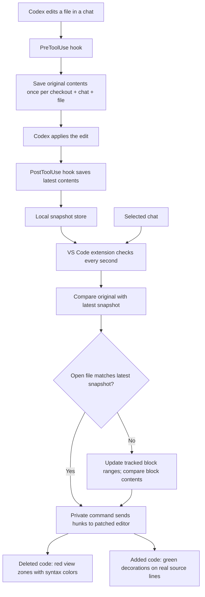

# How Codex chat diffs work

The Codex Mac app edits the checkout normally. Hooks record before/after contents, a companion extension computes each chat's accumulated diff, and a patched VS Code editor displays it in the actual file.

## Capture and storage

`hooks/capture.cjs` receives structured Codex hook events. The first pre-edit event stores the file's original contents, including any existing uncommitted work. Later edits in that chat retain this baseline. Post-edit events record actual file contents, rather than assuming the proposed patch succeeded.

Snapshots live under `.prototype-runtime/captures/<checkout-hash>/<chat-hash>/`. Each chat retains its own original and latest version, so later chats do not overwrite its history. `session.json` identifies the chat and checkout; pending records correlate before/after events by tool-call ID. Files and settings stay local.

## Extension and editor

`src/store.js` loads snapshots for the open checkout. `src/extension.js` provides the chat picker and changed-file list, polls once per second, and computes hunks using `src/diff.js`. Short unchanged gaps consisting only of braces, punctuation, or whitespace are merged into their surrounding replacement. Meaningful unchanged lines remain boundaries.

The private `_codexDiff.setChanges` command forwards the selected chat's file snapshots and hunks to `prototype/runtime-overlay.js`. `src/review.js` tracks the character ranges belonging to captured blocks. Content-change events update each range and recompute its diff against the block's original text. Typing inside a block remains reviewed; Enter at its first column creates an independent line above the block; Enter at its final column starts independent code below it. Outside edits shift anchors without becoming green additions. Recent undo/redo states restore boundary ownership, and the isolated workspace state saves current boundaries between launches. Hook snapshots remain unchanged by manual edits.

Deleted rows are editor **view zones**, not inserted document text. They occupy real visual space between source lines, but do not enter saves, formatting, or language-server input. Their text is escaped and tokenized through VS Code's internal tokenizer with the file's language and theme token classes. Additions are normal decorations on the actual source lines.

## Why a patched copy?

Standard extension decorations could not create additional deleted-code rows inside a normal editor. The hash-pinned patch exposes the required internal view-zone access and a narrow command bridge. The disposable app has a local development signature; the original VS Code installation is not patched. VS Code's own modified-installation warning remains enabled.

The launcher explicitly identifies the bundled extensions directory and uses an isolated profile, shared storage, and user extension directory. Built-in themes and language grammars are cloned from the copied app into the isolated profile outside the repository. This prevents Restricted Mode from disabling them as workspace-contained extensions. Custom extensions from the normal installation are not automatically imported.

## Current boundaries

- Captures `apply_patch` edits only, not arbitrary shell or MCP filesystem edits.
- Captures begin after hooks are installed, trusted, and loaded by the chat.
- Whole-file deletions are listed but have no existing file editor to decorate.
- Overlapping concurrent edits are not transactionally attributed.
- Files must be UTF-8 text within the working directory and below the capture/diff limits.
- Chat IDs identify sessions because hook events do not provide chat titles.

See [hook setup](../hooks/README.md) and [disposable app setup](../prototype/DISPOSABLE-COPY.md).

## Accept and reject

Each rendered block has a compact action row. Buttons call `codexDiff.reviewBlock` through the private command-service bridge. The extension validates the selected chat, exact editor text, and a hash of current block boundaries before acting. Accept removes the block from local review state without changing source text. Reject applies an undoable workspace edit restoring that block’s original lines, then removes its overlay. Both actions save the document through `src/review-save.js` and the private `_codexDiff.saveReviewFile` workbench command. The native text file service retains conflict checks and skips save participants so formatting cannot add undo steps. Save failures are reported; the decision remains applied and undoable.

Accept also pushes a resource-scoped entry into VS Code’s native undo/redo service through `prototype/review-undo.js`. It stores the before/after review regions, closes the preceding text-edit undo group, and restores review state through the companion extension. No dummy text edit is inserted. Restoration checks the captured snapshot and editor contents before applying, so an obsolete undo entry cannot overwrite newer capture state.

Undo/redo of acceptance saves through the same review saver. Undo/redo of rejection is recognized by its explicit before/after snapshots and schedules a save after the native undo operation completes. Ordinary typing and unrelated undo/redo do not request review saves. Saves are serialized per file, and a pending undo save is skipped if further typing changes the document before it runs.

Successful review saves persist the saved text with the file's review state. This becomes the common base for the next incoming capture, so saved rejections and personal edits are not mistaken for new conflicts against an older hook snapshot. Once that capture is reconciled, its contents become the incoming merge baseline again.

## Git checkpoints

`src/git-review.js` reconciles captures with the local repository during refresh. It only settles a file when Git reports no staged or working-tree changes, the file matches the committed blob in `HEAD`, and any open buffer is clean and matches that blob. Committed deletions settle when the path is absent from both `HEAD` and disk. Untracked and ignored existing files, dirty buffers, non-Git folders, and Git failures retain their reviews. Partial commits across files settle the clean files independently; a file with remaining uncommitted changes stays in review.

Settled capture fingerprints and committed contents persist in workspace state. The extension clears their pending regions and conflicts without deleting hook history or writing source files. A new capture in the same chat uses the checkpoint as its starting baseline, preventing committed changes from reappearing. Branch changes update that baseline to the current checkout. Each linked worktree is checked against its own `HEAD`; no push or network request is needed.

A saved rejection that restores `HEAD` is not treated as a committed checkpoint. Git reconciliation consults the live review's rejection records and preserves its undo metadata, including across relaunches. Undo revives the pending regions and saves the restored proposal; redo saves the rejection again. A later commit of the proposal still settles the review normally. Checkpoints incorrectly created by the earlier cleanup are released when their original proposal is restored in a dirty buffer or working tree.

Review saves pass the expected disk version to the workbench bridge. If an external capture arrived before the editor's file watcher updated its metadata, the bridge refreshes the saved stat only after reading an exact match for those known contents. The subsequent native save retains its etag/mtime checks, so a newer external write still causes a conflict instead of being silently overwritten.

## Explorer file attachments

`src/chat-context.js` contributes **Add to Codex Chat** to Explorer's file context menu and forwards the clicked file URIs to the bundled `chatgpt.addFileToThread` command. Multi-selection is supported; folders and non-file resources are skipped. `scripts/codex-file-context.cjs` patches the pinned native attachment helper to preserve the last focused Codex editor-panel chat before it can switch to the sidebar. Sidebar startup and pending attachment queueing use the native path. Attachments populate the composer without sending a message.

## Incoming edits while the editor is dirty

`src/merge.js` compares the last captured version, current editor buffer, and incoming Codex version. Changes to independent lines merge into the buffer using an undoable workspace edit. Overlaps, including edits to code the user has rejected, preserve the buffer and queue the incoming snapshot. A warning and persistent status-bar action expose resolution: load the incoming version (undoable), or retain the editor version. Pending conflicts persist in workspace storage. No automatic save or silent buffer replacement occurs. On first upgrade, existing divergent dirty buffers are surfaced as conflicts because their prior edit provenance is uncertain.

Rejections keep explicit before/after text and region snapshots, separately from the general typing cache. Undo/redo uses these records to restore block ownership even after that cache is reset. Metadata-only document events do not change region history. Recent rejection records are persisted with local review state.

### Conservative stale-review cleanup

Older reviews re-anchor across unrelated edits. Exact restorations of the original
block contents are resolved automatically, including restorations surrounded by
unrelated edits. Previously accepted regions stay resolved. Trial reconciliation
changes only in-memory review metadata and persists successful results; it never
writes file contents. History is retained so undo can restore pending blocks.

Code being present does not prove user acceptance: incorporated but unaccepted
changes remain ordinary pending diffs. Different overlapping replacements, repeated
text elsewhere, and unsupported comparisons are not treated as proof of resolution.
They remain normal pending blocks in the sidebar, showing the captured change.
Only diffs safely mapped to current text render inline. Accept resolves the block
without touching the file; reject computes an inverse merge into the live buffer
and stops on overlapping newer edits. Navigation includes these pending files.
No “Keep current file” or separate history state is needed.

New captures build on the prior review’s effective baseline (current text with only
unaccepted blocks reverted), preserving accepted decisions rather than rebuilding
all changes from the chat’s first snapshot. Native accept undo stores the review
text separately from live document text, so accepting older changes can be undone
without restoring an obsolete file version.
